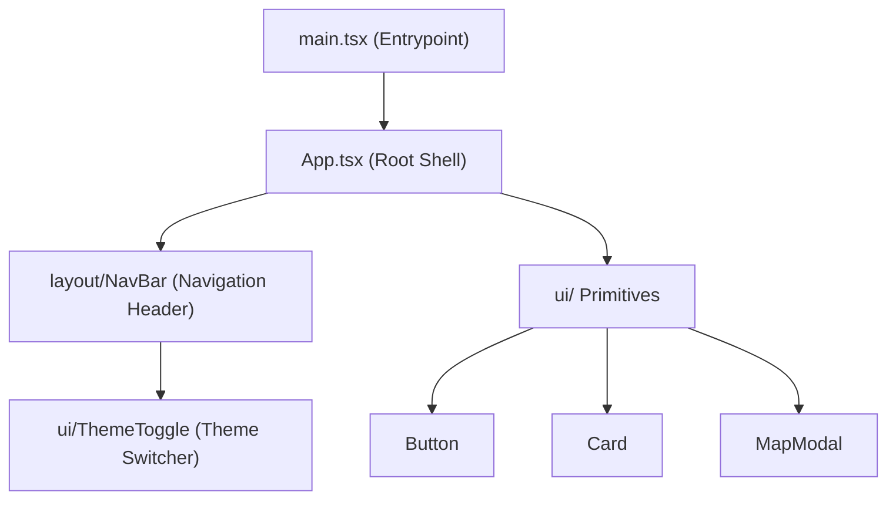

# Nicoly Portfolio (`@vitoria-rodrigues/nicoly-portfolio`)

Interactive web portfolio built with React 19, TypeScript 6, React Three Fiber, React Router 8, and Vite 8, configured with automated quality validation and Vercel production deployment.

---

## 1. Technology Stack

- **UI Library**: React 19.3
- **3D Rendering**: Three.js (`@react-three/fiber`, `@react-three/drei`)
- **Routing**: React Router 8
- **Language**: TypeScript 6.0
- **Build Tool**: Vite 8.3
- **Styling**: Modular CSS Modules and global CSS variables
- **Code Quality**: ESLint 10 and Prettier
- **Package Management**: pnpm 10 with `catalogMode: strict`
- **CI/CD & Hosting**: GitHub Actions + Vercel

---

## 2. Architecture Overview

The frontend separates layout chrome from reusable UI primitives using CSS Modules for style isolation.



### Project Structure

```text
nicoly-portfolio/
├── .agents/
│   └── plugins.json                    # Antigravity plugin registry (@vitoria-rodrigues/agent-mesh)
├── .github/
│   └── workflows/
│       └── vercel-deploy.yml           # CI validation and Vercel production deployment
├── public/
│   ├── favicon.svg
│   └── icons.svg
├── src/
│   ├── assets/                         # Static visual assets
│   ├── components/
│   │   ├── layout/
│   │   │   └── NavBar/                 # Top navigation component and styles
│   │   └── ui/                         # Reusable UI components (Button, Card, MapModal, ThemeToggle)
│   ├── App.css
│   ├── App.tsx
│   ├── index.css
│   └── main.tsx
├── AGENTS.md                           # Sovereign root context router (Layer 1)
├── eslint.config.js                    # ESLint flat configuration
├── index.html
├── package.json                        # Scoped manifest (@vitoria-rodrigues/nicoly-portfolio)
├── pnpm-lock.yaml                      # Deterministic pnpm lockfile
├── pnpm-workspace.yaml                 # Centralized pnpm dependency catalogs
├── README.md                           # Primary developer documentation
├── tsconfig.app.json
├── tsconfig.json
├── tsconfig.node.json
├── vercel.json                         # Vercel routing and build overrides
└── vite.config.ts                      # Vite bundler configuration
```

---

## 3. Getting Started

### Prerequisites

- Node.js 20 or higher (CI targets Node.js 22)
- pnpm 10 or higher

### Installation & Local Development

1. Clone the repository:

```bash
git clone https://github.com/Vitoria-Rodrigues/nicoly-portfolio.git
cd nicoly-portfolio
```

2. Install dependencies:

```bash
pnpm install
```

3. Start the local development server:

```bash
pnpm dev
```

---

## 4. Key Scripts

| Command | Description |
| :--- | :--- |
| `pnpm dev` | Starts the Vite development server with Hot Module Replacement (HMR). |
| `pnpm build` | Typechecks via `tsc -b` and bundles production assets with Vite. |
| `pnpm preview` | Serves the production build locally for validation. |
| `pnpm lint` | Executes ESLint across project source files. |

---

## 5. CI/CD Pipeline

Pull requests and pushes to `main` trigger [.github/workflows/vercel-deploy.yml](./.github/workflows/vercel-deploy.yml):

1. **Quality Validation (`validate`)**: Installs dependencies using `pnpm install --frozen-lockfile`, runs `pnpm run lint`, and validates `pnpm run build`.
2. **Production Deployment (`deploy`)**: Runs on pushes to `main` after validation passes, building and deploying to Vercel via prebuilt artifacts.

---

## 6. AI Agent Mesh Integration

This repository consumes organizational AI agent skills, rules, and MCP configurations via `@vitoria-rodrigues/agent-mesh` declared in `catalog:plugins-stack` ([pnpm-workspace.yaml](./pnpm-workspace.yaml)) and mounted through [.agents/plugins.json](./.agents/plugins.json).

---

## 7. Governance Standards

1. **Conventional Commits**: All commits must follow `<type>(<scope>): <description>` (v1.0.0).
2. **Cryptographic Signing**: Sign commits with SSH (`git commit -S -m "..."`) when a signing key is configured.
3. **Zero-Emoji Invariant**: Emojis are strictly prohibited in code, documentation, and commit messages.
4. **Language Policy**: Technical documentation, code, and commit messages are written strictly in en-US.
